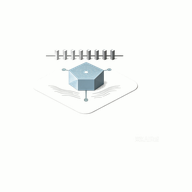

<div align="center">
  
  <h1>RikkaHub Neomix</h1>

基于 [RikkaHub](https://github.com/rikkahub/rikkahub) 的**非官方**定制版 —— 原生 Android LLM 聊天客户端（多提供商 / Agent 工作区 / TikZ 渲染）

[English (上游原版 README)](README-en-origin.md)
</div>

> ⚠️ **非官方 fork**：与上游 [rikkahub/rikkahub](https://github.com/rikkahub/rikkahub) **无从属关系**，上游不处理本项目的问题；
> 本项目由个人维护，代理、S3、MLTS等部分功能未经测试，**不承诺及时响应**。AGPL-3.0 许可，保留上游 `LICENSE` 与出处。
> 应用显示名 **Neomix**（仓库名 `RikkaHub-Neomix`），包名 `app.androidrik.rikkahub`。

## 📌 与上游的关系

- **基线**：上游 `2c980642`（`2.4.5` 一线）。本仓历史 = **上游真实提交（哈希未变）** + 本项目的定制提交。
- **跟进方式**：不整体合并上游；按需人工评估后**选择性吸收**（关键修复 / 低成本高价值功能），提交信息中标注来源。
  逐条评估记录见 [`docs/upstream-analysis.md`](docs/upstream-analysis.md)（**当前已跟进到上游 `05b655bb`，2026-10-13，无欠账**）。
- **发布前重写**：本项目在私有仓迭代，公开前对**包名**与**提交身份**做了重写，因此历史短哈希与私有仓不同——
  文档中出现的旧短哈希无法在本仓定位，请用提交信息关键词检索（见 [`docs/README.md`](docs/README.md)）。
- **不回推上游**：上游明确不接受 PR，故本项目改动不回推。
- **本仓不提供预编译包**：请自行构建（见下）；CI 自动发版已禁用。

## ✨ 本项目定制功能

在继承上游全部能力的基础上，本项目做了以下定制。

> 不在下表的两类：①**吸收自上游**的修复与功能；②**上游同样具备**、只是实现来源不同的能力。两者都归入下面「核心功能（继承上游）」。

**对话与生成**

| 功能 | 说明 |
|---|---|
| 🩹 **半截回复保留与重试分流** | 弱网/断流失败时保留已有内容为可编辑草稿（阈值可配）；按失败类型分流（仅零输出失败换 key / 重试），有 fallback 时压缩主模型重试预算以快速切换 |
| 🧠 **自动上下文压缩** | harness 式检查点压缩：轨迹只追加、可展开回看可编辑、编辑自动失效、参数可配置档 |
| 📊 **上下文容量面板** | 剩余/占用/上限 + 预计可容纳轮数 + 上下文组成明细 + 一键压缩；标题旁占用读数；输入栏指示器细条/圆环可切换 |
| 🧮 **真 tokenizer** | cl100k BPE 精确 token 计数（估算、统计、预算判定同源），后台预热 + 启发式兜底 |
| 🧷 **消息引用** | QQ 式引用（快照 + ID 双存、输入框预览卡、点击跳转、队列携带）——对应上游 issue #1906，**上游 2026-10-01 以「AI 看不到引用、本质都是文本」为由 closed as wontfix，未实现** |
| 🏷️ **生成来源标注** | 每条回复末尾可选显示实际「路由 · 模型」（默认关，多中转核对/成本归因）——对应上游 issue #1805，上游尚未实现 |
| 🔍 **拼装预览与缓存诊断** | 发送前提示词逐段归因（Tier 1–4，可点注入段跳到产出条目、工具 schema 独立成段）；缓存稳定性三档分组；**前缀分叉诊断**（对比上次/本次请求，定位缓存断点并估算可命中前缀） |

**Agent / 工作区**

| 功能 | 说明 |
|---|---|
| 🤖 **子代理系统** | 独立上下文（信封隔离父对话注入）+ 对话内派发 + 升级到人审批 + 并行上限 + 上下文预算 |
| ⚙️ **工作区后台任务** | `run_background / status / kill` 三工具 + 完整输出落盘 `.tasks/` + 30 分钟时长上限 + 可见性 UI |
| 🧯 **护栏与预算** | LoopGuard 三档制（严格/标准/宽松）+ rootfs 单轮字符/步数预算 + 子代理并行上限——全部可配 |
| 📦 **工作区增强** | 长按多选导出（zip/目录两种产物 + 批量删除）、HTML/SVG 预览、Shell 兼容模式 |

**知识与提示词**

| 功能 | 说明 |
|---|---|
| 📚 **RAG 知识库** | 跨库向量检索工具 `search_knowledge_base`（per-KB 嵌入模型、导入即解析入库） |
| 🎭 **SillyTavern 深化** | 官方语义的世界书（多源扫描 / token 预算 / 次要关键词）、ST 预设导入、角色卡 V1 兼容、注入位置批量迁移（缓存友好）、世界书种子三重迁移 |

**网络与提供商**

| 功能 | 说明 |
|---|---|
| 🔑 **提供商多 Key** | 每 key 独立输入框 + 启用开关 + 拖拽排序（列表顺序=优先级，首个=首选）；失败转移覆盖 401/403/429、余额耗尽、TPM/RPM 限流（含中转站 SSE 流内错误无状态码形态）——仅零输出失败换 key（半截保留草稿不换）；搜索侧同套结构 |
| 🛟 **备用模型链（fallback）** | 主模型整轮失败自动切备用重跑；助手级 > 全局默认两级，引用失效自动回退 |
| 🏷️ **启停与真删除** | 提供商/模型/助手/ASR/TTS 均可停用（不阻断既有使用）与真删除（悬空引用保护 + 迁移兼容） |
| 🔄 **模型拉取反馈增强** | 自动拉取模型列表、失败显示错误卡 + 重试、候选模型搜索/全选添加 |

**备份与数据**

| 功能 | 说明 |
|---|---|
| 💾 **备份加固与互通** | 兼容上游原版包名（`me.rerere.`）备份自动迁移；大文件加固（STORED 采样 + S3 分片 8MB + 单遍哈希 + 空间预检/字节级进度 + 换库前完整性校验）；生成的图片纳入备份 |
| 📦 **对话导入导出** | 自家格式 zip + 附件原字节往返（导入即换新 id）+ 统一导入器 + 导出留存区（TTL 自动清理） |
| ⭐ **收藏管理增强** | 基础收藏继承上游，本项目增量：标签筛选/管理页、排序切换、双向侧滑撤销 |
| 🧾 **Token 统计增强** | 上游已有总量/按天统计，本项目增量：实际消耗与当前对话双口径、按模型（名称快照防悬空）、按天热力图、缓存命中率 |

**稳定性与安全**

| 功能 | 说明 |
|---|---|
| 📝 **日志落盘** | 请求日志可落盘 `files/logs`，敏感请求头双重脱敏 |
| 📐 **TikZ 图表渲染** | mupdf SVG 路线（`$$...$$` 内嵌 + `tikz` 围栏双触发；导出 HTML 内嵌矢量）；三层崩溃防线（尺寸校验/生成端上限/采样上限 + HeightClamp） |

**界面**

| 功能 | 说明 |
|---|---|
| 🧩 **代码块一键设为助手** | 会话内 JSON 助手卡即点即用 |
| 🧹 **移除上游营销** | 移除应用内更新检查、赞助入口/捐赠页/启动次数赞助弹窗、导出图片中的 `rikka-ai.com` 品牌水印 |

## 🧪 未在设备上验证（从上方清单移出）

以下功能**已实现**，但在本项目的开发记录里**没有真机 / 端到端验证**（或明确标注待验证），故不计入上方「定制功能」。
补验清单与逐条状态见 [`docs/handoff-2026-09-04.md`](docs/handoff-2026-09-04.md) §三.6「验证债」（**该节最后刷新 2026-10-12**）。

| 功能 | 状态 | 为什么单列 |
|---|---|---|
| 🛟 **会话加载守卫** | 已实现 | 属防护性改动，真机未复现触发场景，无验证条目 |
| 🌐 **两层代理** | 已实现 | 设计文档明确「**待用户真机验证**」（需真实 SOCKS5 / HTTP 代理） |
| 🛡️ **MCP 加固**（mTLS 客户端证书） | 已实现 | 无验证条目（连接错误三分类另有真机通过） |
| 🐕 **后台保活**（KeepAlive / WifiLock） | 已实现 | 开发记录中无验证条目 |

**部分未验证**（主体已真机验证、个别子项有缺口）：

- **子代理系统**：Phase 1 真机验证通过；**并行上限拒绝、预算耗尽优雅停仅单测**，真机待验。
- **备份加固与互通**：备份体系重构 / 空间预检已真机验证；**S3 远端同步部分未经验证**（含大文件 8MB 分片）。

## 🎨 核心功能（继承上游）

- 🎨 Material You 设计 + 🌙 深色模式
- 📦 Workspace：基于 proot 的 Linux Agent 运行环境
- 🖥️ 终端多 Tab（会话管理 + PTY 动态标题）
- 🔄 多 AI 提供商：自定义 API / URL / 模型（OpenAI、Google、Anthropic 兼容接口）
- 🖼️ 多模态输入（图片、文本、PDF、Docx）
- 🎨 图像生成（Imggen）
- 🎙️ 语音（TTS / ASR）
- ⏯️ 消息队列（生成中连发自动入队）
- 🖥️ Web 访问，多平台使用
- 🛠️ MCP 支持（含 OAuth 授权、工具 schema `$defs` 内联展开）
- 📝 Markdown 渲染（代码高亮、LaTeX 公式、表格、Mermaid）
- 📊 图表工具（`chart_display`：折线 / 柱状 / 散点）
- ✨ ExpressivePopup（Material Expressive 动效弹层）
- 🗂️ 模型列表折叠（按供应商分组）
- 🪾 消息分支 / 🔍 搜索能力（Exa、Tavily、智谱、豆包、LinkUp、Brave、Perplexity 等）
- 🧩 提示词变量 / 🤳 提供商配置二维码导出导入 / 🤖 Agent 自定义
- 🧠 类 ChatGPT 记忆功能 / 📝 AI 翻译 / 🌐 自定义 HTTP 请求头与请求体
- 📦 内置技能（skill-creator 等随包内置）
- ☁️ 备份与恢复（S3 / WebDAV / 本地）/ ⭐ 消息收藏 / 📤 分享 / 📊 统计
- 💌 SillyTavern 角色卡导入

## 🙏 借鉴与参考的应用 / 项目

本仓的功能大量吸收了同类优秀项目的做法。**只在「核实过源码或文档、并确实据其改进自己实现」时才列在这里**；
每条都注明「借鉴了什么」，评估过程与逐条结论见 [`docs/peer-apps-benchmark.md`](docs/peer-apps-benchmark.md)。
致谢以下项目及其作者（排名大致按借鉴程度）。

| 项目 | 来源 | 借鉴了什么 |
|---|---|---|
| **RikkaHub** | [rikkahub/rikkahub](https://github.com/rikkahub/rikkahub) | 本仓的上游基线；上游修复与功能按需**人工逐条评估后选择性吸收**（不做 ff-only 同步，改动不回推上游） |
| **Yuihub** | [xiaoyuili/Yuihub](https://github.com/xiaoyuili/Yuihub) | 借鉴最多的一家：记忆打分校准 + 字符预算、被动提取管道的组织方式、整理器（先落库再删源 / 幂等）、工具结果投影无损回环校验。**其「记忆语义检索上线一天即整套删除」也被本仓引为「不做语义检索」的独立佐证** |
| **SillyTavern** | [SillyTavern/SillyTavern](https://github.com/SillyTavern/SillyTavern) | 世界书/提示词注入与预设体系（Tier A/B 系列落地）、ST 宏运行时移植；其余按需 |
| **华灯**（rikkahub-sillytavern-android） | [MiaoWuNYA/rikkahub-sillytavern-android](https://github.com/MiaoWuNYA/rikkahub-sillytavern-android) | 工具输出「投影无损回环校验」原则、R8 序列化 keep 纪律等（另有一项 Jev 契约仍待评估） |
| **SoLab** | 见下方备注（基于 Kelivo 二次开发，MT 论坛分发） | 世界书 seed 三重迁移、工具调用失控护栏（LoopGuard + forget）的理念 |
| **senera** | [yuanplussfive/senera](https://github.com/yuanplussfive/senera) | MCP 工具 schema 动态分层加载（元工具桥、内容寻址缓存）的成熟参考实现 |
| **MineChat** | 见下方备注 | RAG-as-tool 知识库检索移植、输入侧正则与动态宏（st 宏运行时） |
| **agentd** | [hue913/agentd](https://github.com/hue913/agentd) | 经验记忆 + 信用记账（已接进记忆打分） |
| **rikkahub-pro**（Turbo） | [dcs666/rikkahub-pro](https://github.com/dcs666/rikkahub-pro) | R3.2 块级流式渲染、`setJob` 修复；其 80+ bug 清单被本仓用作 bug 审计对照表 |
| **RikkaHub Math+** | [test27818/rikkahub-math-plus](https://github.com/test27818/rikkahub-math-plus) | TikZ 渲染管线架构（检测 → preamble 生成 → 编译 → 三层缓存）与 `standalone[border]` 裁剪留白的作法 |
| **橘瓣 OrangeChat** | [watermio123-droid/orangechat](https://github.com/watermio123-droid/orangechat) | 同为 RikkaHub 系的深度定制，做过逐项借鉴评估（QuickJS 插件系统评估后**确定不做**） |
| **rikkahub-agent** | [ExTV/rikkahub-agent](https://github.com/ExTV/rikkahub-agent) | Agent 化的同类探索（与上游 `3a533a6a` 一并做过终端/工具链分析） |

**仅作设计参考、未采用其实现细节的**：`opencode` / `codex` / `Cherry Studio` —— 子代理与独立上下文设计稿只借其**思路**，
其实现细节本仓**未核实、也未抄**（见 [`docs/design/design-subagent-context.md`](docs/design/design-subagent-context.md)）。

> **备注（两个无法直接给链接的）**：`SoLab` 与 `MineChat` 的来源是本地拿到的源码包 / 论坛分发版本，**本仓没有可靠公开仓库地址**，
> 故只按项目名致谢、不伪造链接。若作者愿意提供正式链接，欢迎提 issue 或 PR 补上。
>
> 以上项目各有其许可与版权；本仓仅在**思路与实现参考**层面借鉴并自行重写，未直接复制其代码；对上游 RikkaHub 则保留原
> `LICENSE` 与出处（见下方 License）。

## 🧱 原生库（预编译签入）

`app/src/main/jniLibs/arm64-v8a/` 下的 `.so` **手工签入，Gradle 不参与编译**：

| 库 | 源码 | 说明 |
|---|---|---|
| `libtex_poc.so` | [`tools/tex-poc/`](tools/tex-poc/)（Rust，Tectonic 0.17） | TikZ 渲染的 TeX 引擎；重编前置（NDK r27c / 交叉库 / patchelf）见该目录 README |
| `libpdf2svg_bridge.so` | `app/src/main/cpp/pdf2svg_bridge.c`（自包含，自带 mupdf 原型声明） | mupdf 把 tectonic 的 PDF 转 SVG（文字转轮廓） |
| `libmupdf_java.so` / `libsimple.so` / icu / graphite2 | 上游 / 第三方 | — |

> JNI 符号名与**包名绑定**（`Java_app_androidrik_rikkahub_tikz_*`）：改包名必须按新符号重编这两个库，否则运行时 `UnsatisfiedLinkError`。

## 🛠️ 构建指南

环境要求：

- **JDK 21**（构建验证版本；`sourceCompatibility` / `jvmTarget` 为 **17**）
- **AGP 9.3.1** / **Gradle 9.5**
- Android SDK（release 走 R8 混淆，需签名）
- `web` 模块在 `preBuild` 阶段构建 `web-ui/`，需要 Node + pnpm

步骤：

0. **初始化子模块**（首次克隆必须）：`git submodule update --init --recursive`
   —— `material3` 模块依赖 `material-color-utilities`，不初始化会报 `Unresolved reference 'dynamiccolor'`
0b. **安装 web-ui 依赖**（首次）：`cd web-ui && pnpm install`
   —— 构建时 `:web:buildWebUi` 会执行 `pnpm run build` 并把产物写进 `web/src/main/resources/static`（约 13 MB，已 gitignore）。
   只想快速验证编译可加 `-x :web:buildWebUi` 跳过；此时 APK 内不含 Web 访问静态资源。
1. `local.properties`（**仓库根目录**，不入版本控制）：
   ```properties
   sdk.dir=<Android SDK 路径>
   # release 签名（可选，不配则 release 不签名）
   storeFile=<keystore 路径>
   storePassword=***
   keyAlias=***
   keyPassword=***
   ```
2. `app/google-services.json`（**占位即可**，package 需匹配 `app.androidrik.rikkahub`；debug 变体需额外 `.debug` client）
   —— 缺失时 release 可编译，但运行时 Firebase 初始化会崩
3. Debug：`bash scripts/build.sh :app:assembleDebug`；Release：`bash scripts/build.sh release`
4. 产物：`app/build/outputs/apk/release/app-{arm64-v8a,universal,x86_64}-release.apk`（本项目只发 arm64-v8a）
5. 测试：`bash scripts/build.sh :app:testDebugUnitTest`

> 只想快速验证编译：`./gradlew :app:compileDebugKotlin -x :web:buildWebUi -q`（跳过 web-ui 构建）。
> Gradle wrapper 下载可能超时，可用本地缓存 `~/.gradle/wrapper/dists/gradle-9.5.0-all/.../gradle-9.5.0/bin/gradle`。

## ⚠️ 已知问题与排查记录

### 中转站模型报「no effective pricing」

- **现象**：通过中转站（new-api / one-api 类网关）调用部分模型时返回 `Current group has no effective pricing for model <模型名>`
- **根因**：该模型在中转站已被撤下/失效，或当前 API key 所属**用户组**未为该模型配置**有效定价**——**与客户端无关**
- **处理**：在中转站后台确认模型是否仍上架；换用仍有效的模型 id；或为该 key 组绑定模型定价

## 🧱 技术栈

- [Kotlin](https://kotlinlang.org/)（2.4）/ [Jetpack Compose](https://developer.android.com/jetpack/compose)
- [Koin](https://insert-koin.io/) / [Room](https://developer.android.com/training/data-storage/room) / [OkHttp](https://square.github.io/okhttp/)
- [kotlinx.serialization](https://github.com/Kotlin/kotlinx.serialization) / [Material You](https://m3.material.io/) / [Navigation 3](https://developer.android.com/guide/navigation/navigation-3)

## 📄 License

[GNU Affero General Public License v3.0](LICENSE)（AGPL-3.0）。
本项目基于 [RikkaHub](https://github.com/rikkahub/rikkahub)（AGPL-3.0），上游原版 README 见 [`README-en-origin.md`](README-en-origin.md)。
