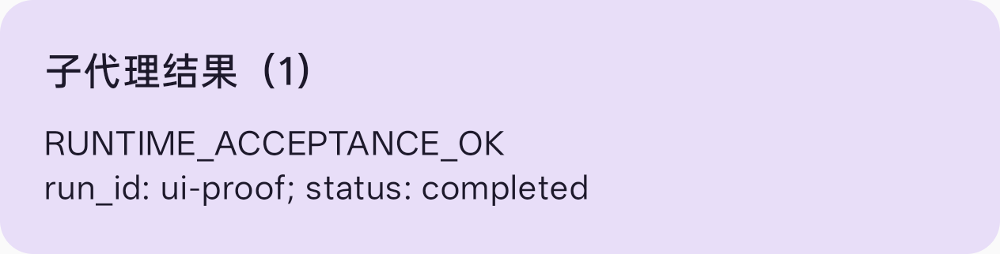

# P1a 验收记录（2026-11-02）

## 结论与范围

GLM-4.7 真实模型、PJX110 / Android 15：SYSTEM 长时 run、父会话 busy 后补投、杀进程后补投、
USER 回退载体和两种载体的 Compose 卡片验证通过。后台派发总开关仍默认关闭，载体默认 SYSTEM。

测试使用单独的 `runtime-acceptance.db` 与 `runtime-acceptance/isolated-settings.preferences_pb`。
正常应用的提供商、模型选择和会话数据不作为测试写入目标。两个真实模型测试批次均验证正常设置
文件的前后 SHA-256 一致。早期验收夹具曾使用正常调试配置，现已改成显式隔离文件，移除了读取/
克隆正常提供商的测试入口；后续测试不再重置用户配置。

临时 API key 通过隐藏终端输入交给本机回环代理，仅留在代理内存；手机使用占位凭据。
key 未写入代码、报告、测试参数或手机设置。验收后代理与 ADB 转发已清理，电池模拟状态已恢复。

## 结果

| 场景 | 结果 |
|---|---|
| SYSTEM + GLM-4.7 长时任务 | 189763ms；真实模型调用受限测试工具，工具等待 180 秒，返回后由真实模型生成最终结果 |
| 父会话 busy | 子 run 结束时仍 pending，父会话没有 notice；释放 busy 后投递一次，不自动续跑 |
| 外部杀进程 | 工具已进入、账本已持久化后由宿主 force-stop 调试包；新进程 INTERRUPTED + delivered，一条 notice |
| 强制 Doze | 成功进入 deep IDLE；系统结束该测试进程；恢复后中断结果成功补投 |
| USER 兼容载体 + GLM-4.7 | 12229ms 的短工具任务；busy 后补投、外部杀进程后补投均通过，保留来源注解 |
| Android UI | SYSTEM / USER 两例均显示独立“子代理结果”卡片和结果正文，截图已检查 |
| 单测 | app 2804 例，0 失败、2 跳过；ai 479 例，0 失败 |
| IME 审计 | A=0，A'=0；既有 B/C 告警保留 |

验收边界：真实的是子代理模型请求及其工具循环。父会话 busy 由生产 `ConversationSession.setJob`
注册一个受控 Job，释放后经过生产 generation-finished 回调和投递泵；没有同时运行第二个付费父模型。
恢复测试在新的隔离 instrumentation 进程内调用生产 `AgentRunReconciler` 和 `ChatService.startNoticeDelivery`，
没有把测试配置交给正式 Application 启动。UI 测试渲染生产 `ChatMessage` 的 notice 分支，不等于完整聊天页的
手工导航验收。Doze 案例不证明无限后台存活，验证的是进程消失后不会留假 running，并能投递中断结果。

## 回退语义与附带修复

- `noticeCarrier=system|user` 持久化，默认 SYSTEM；预设页在后台总开关开启时提供兼容模式开关。
- USER 仅改变存储/传输载体：语义角色、消息分组、导出标签仍为 SYSTEM；标题、建议、记忆整理不把它当用户意图。
- 请求副本加 `<system-reminder>` framing，原文不改；输入模板、宏与插件对原有 notice 的正文改写不落入请求副本。
- 正常取消 `toMutableStateFlow` 的订阅不再执行 `Runtime.halt(1)`；这个问题由真实验收的清理阶段发现，已加回归。

## 复现

仅在专用调试包上运行；以下命令不会安装/覆盖 release 包。代理仅支持回环访问，真实 key 不写命令行。

```powershell
$env:GRADLE_USER_HOME='D:/A-projects-relay/gradle'
./gradlew :app:installDebug :app:installDebugAndroidTest -PmemoryIsolatedTests=true --offline
python scripts/task_runtime_proxy.py --upstream https://open.bigmodel.cn/api/paas/v4/chat/completions --port 19001
# 在隐藏提示中输入临时 key；另一个终端运行：
adb reverse tcp:19001 tcp:19001
python scripts/verify_task_runtime.py --base-url http://127.0.0.1:19001/v1 --protocol openai --model glm-4.7 --backend real --seconds 180 --carrier system --doze --output .tmp/runtime-acceptance/glm-system-evidence
python scripts/verify_task_runtime.py --base-url http://127.0.0.1:19001/v1 --protocol openai --model glm-4.7 --backend real --seconds 1 --carrier user --output .tmp/runtime-acceptance/glm-user-evidence
# 完成后关闭代理并撤回测试转发：
adb reverse --remove tcp:19001
```

离线受控 SSE 后端：`python scripts/task_runtime_fixture.py --port 19000`，驱动使用
`--base-url http://127.0.0.1:19000/v1 --protocol claude --model runtime-fixture --backend controlled`。
受控后端必须与真实模型结果分开记录。

原始日志及 JSON 结果保留在本地 `.tmp/runtime-acceptance/glm-{system,user}-evidence/`，不包含 API key。




