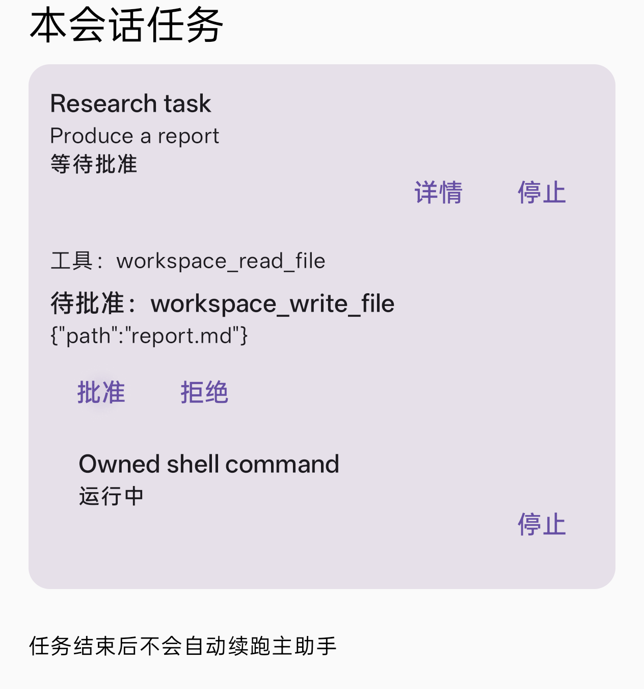

# P1b 验收记录（2026-11-02）

## 结论与范围

完成通知、会话任务树、后台 ASK 审批及子工具信封约束已实现。PJX110 / Android 15 真机隔离验收通过；
本期后台使用受控 SSE 后端验证生产 SubagentRunner、审批队列、数据库与 notice 投递，不调用付费模型。
P1a 的 GLM 长时与进程恢复验收结论见[原报告](agent-task-runtime-p1a-2026-11-02.md)。

测试继续使用独立 DB、隔离 Application 与显式隔离 SettingsStore 文件。正常提供商设置文件的 SHA-256
前后相同；通知权限在各 instrumentation 进程之间调整，结束后恢复原值，没有重置提供商或复用已轮换 key。
本期没有数据库 schema 变更，也没有新增常驻服务、自动父会话续跑或嵌套派发。

## 功能行为

- 手动与后台 run 进入终态后使用独立结果渠道发通知。终态 SQL 首次成功才发，重复收尾不重复发；
  通知与详情 PendingIntent 都按 runId 分配，打开详情只撤该 run 的通知。前台相关会话、运行详情或
  Agent 任务中心可见时抑制；权限、应用通知总开关或渠道不可用时静默。
- 聊天顶部新增“本会话任务”入口，展示关联 run、最近工具、待批参数、归属 shell 和停止/详情/审批操作。
  数据来自按会话过滤的 DAO Flow、工作区不可变 owner 快照和审批队列；没有递归查库。
  当前层级为会话 → run → shell，不启用 P2 多层子代理。直接 shell 只显示当前 turn 或本会话已知 run 的 scope。
- 后台 ASK 在派发时及待批时检测可达渠道。派发时不可达则降级 DENY 并保留原因；待批发送失败立即拒绝。
  等待上限仍为五分钟，超时拒绝；取消/超时清理自己的队列和审批通知。等待期间关闭渠道最迟在超时收尾。
  阻塞派发继续允许通过前台详情审批。UI 审批按请求注册身份检查，旧快照不能批准新请求。
- 子 run 只保留子预设与父轮次最终工具清单的交集。父子工作区不同则排除 workspace 工具段；
  无头始终剔除 `ask_user` 与 `dispatch_subagent`。父清单在实际派发时读取，包含后装配的 MCP/插件。

## 验收结果

| 场景 | 证据与结果 |
|---|---|
| 后台批准 | 生产队列出现待批请求；批准后测试工具执行，run completed，notice delivered |
| 后台拒绝 | 工具未执行，模型收到拒绝结果后收尾；run completed，notice delivered |
| 通知权限关闭 | 系统权限确实撤销，渠道不可达；ASK 降级，工具未执行、无遗留待批，仍 completed + delivered |
| 通知平台 | 可用/禁用/缺失渠道判断正确；失败与取消两个通知同时存在，PendingIntent 不同，撤 A 不撤 B |
| 数据库 | AgentRunDeliveryInstrumentedTest 8/8；新增按父会话查询不串行，其余迁移/幂等/事务/重开验收保留 |
| Compose | NoticeUiAcceptanceTest 3/3；SYSTEM/USER 原卡片与任务树批准操作通过，截图已检查 |
| JVM | app 2819 例（2 跳过）、workspace 161 例（20 跳过），0 失败、0 错误 |
| 审批边界单测 | 不可达不注册、发送失败清理、并行批准与超时独立、取消清理、前台无通知仍可答复 |
| 权限边界单测 | 子信封交集、跨工作区隔离、最终装配清单快照、scope 归属过滤与 UI 可见租约 |
| IME | A=0、A'=0；既有 B=5、C=29 告警保留 |
| 用户配置 | 正常设置文件指纹前后一致，通知权限恢复原值 |

真机共运行通知平台 3 例、审批工具循环 3 场景、DB 8 例、UI 3 例。审批的决定由测试调用生产队列，
并非人工点击通知动作；五分钟超时由协程虚拟时间验证，没有在设备上实等五分钟。
任务树截图为生产内容组件在隔离 UI 宿主中渲染，不代表完整聊天页人工导航验收。
跨 ROM 长时存活、正式 Application 与 KeepAlive 联动仍沿用 P1a 报告的边界。
启动对账的 INTERRUPTED 通过 notice 补投，本期不会为历史对账额外补发完成通知。



## 复现

在调试设备与调试包运行。使用 install 及手动 instrumentation，避免 connectedAndroidTest 自动卸载包清除用户数据。

```powershell
$env:GRADLE_USER_HOME='D:/A-projects-relay/gradle'
./gradlew :app:testDebugUnitTest :workspace:testDebugUnitTest :app:installDebug :app:installDebugAndroidTest -PmemoryIsolatedTests=true --offline --console=plain
python scripts/task_runtime_fixture.py --port 19000
# 另一个终端运行：
adb reverse tcp:19000 tcp:19000
python scripts/verify_task_runtime_p1b.py --base-url http://127.0.0.1:19000/v1
python scripts/audit_ime_trap.py
# 测试完成后关闭 fixture，撤销转发：
adb reverse --remove tcp:19000
```

驱动输出 `.tmp/task-runtime-p1b-evidence/results.json`、各 instrumentation 日志与截图。
测试结束后已关闭本次 fixture、撤销 ADB 转发；证据目录不入库。

## 回滚与后续

后台总开关仍默认关闭，关闭时回原阻塞派发；本期 ASK 与通知不可用降级只影响后台模式，
完成通知可在系统独立渠道关闭。无 DB 迁移，代码按提交回退即可。
设计附录 C 中 P0 的四个用户开关仍未实现，不计入本轮三个体验层交付项。
新文案未要求本地化，后续 key 清单已列在设计附录 D。
